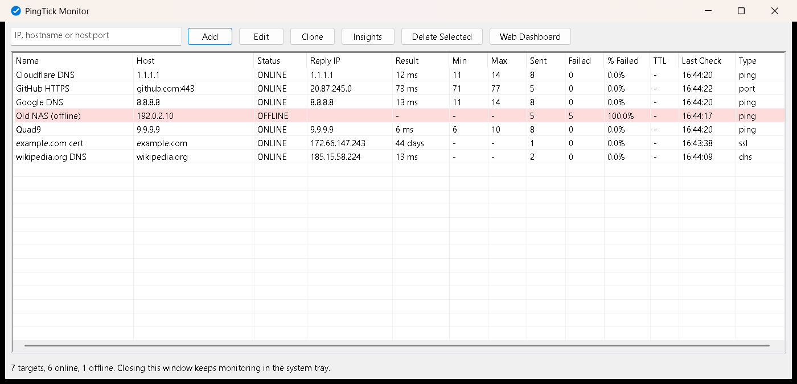
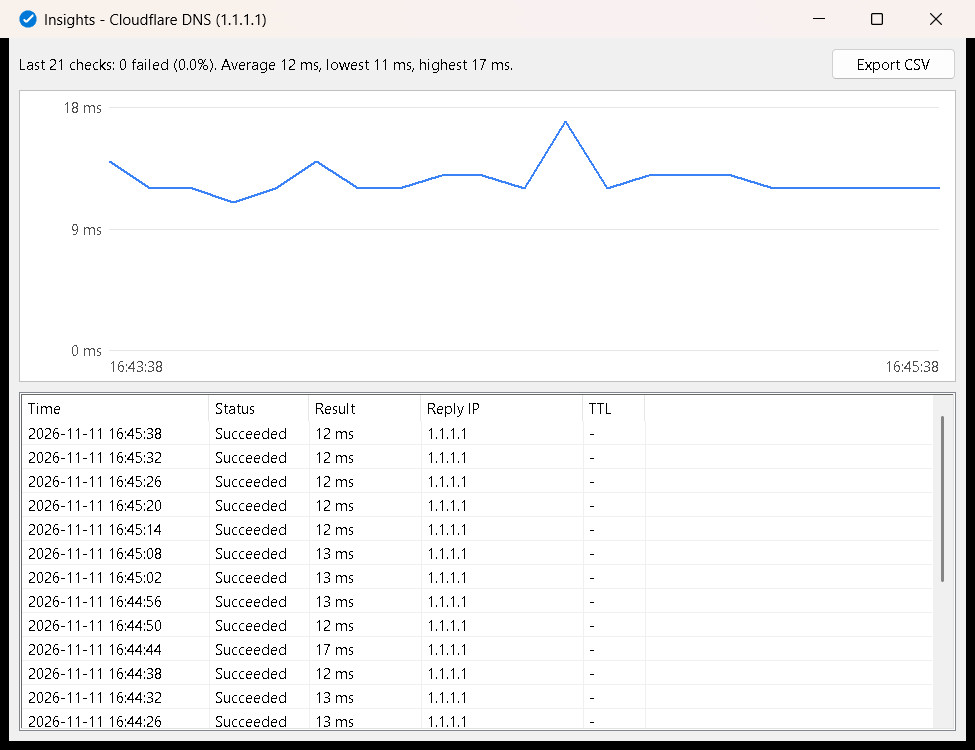
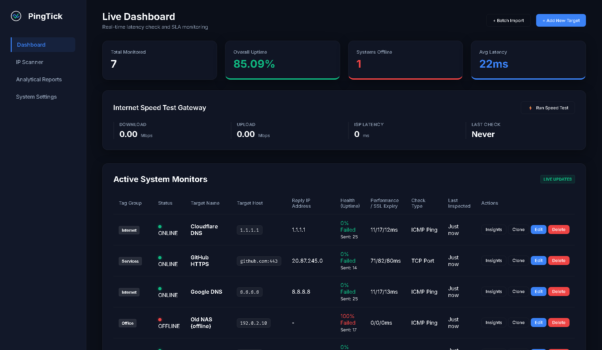

# PingTick

**A lightweight, always-on network monitor for Windows. Watch hosts, ports, certificates and DNS in one table, and get Telegram or email alerts when something goes down.**

[](https://github.com/mtaalamtech/pingtick/releases/latest)
[](https://github.com/mtaalamtech/pingtick/releases/latest)
[](LICENSE)
[](https://go.dev)

PingTick is a free, open-source alternative to PingInfoView for people who leave their monitor running all day. It is a single portable `.exe`, so there is no installer, no runtime to install and no account. It keeps every check in a local database, so you can look back at what happened overnight. Close the window and it carries on quietly from the system tray.

<p align="center">
  <a href="https://github.com/mtaalamtech/pingtick/releases/latest"><b>⬇ Download PingTick for Windows</b></a>
</p>



## Features

- **Native monitor window.** A fast table of every target with status, reply IP, latency, min/max, sent/failed counts and last check. Offline rows turn red, and certificates close to expiry turn amber. You can Add, Edit, Clone and Delete targets right there.
- **Seven check types:**
  - ICMP ping.
  - TCP port (`host:port`).
  - SSL certificate expiry.
  - DNS resolution time.
  - SNMP values.
  - SNMP interface bandwidth.
  - WMI queries.
- **Insights per target.** A latency chart plus the last 500 checks, with one-click CSV export.
- **IP scanner.** Sweep a range of up to 4,096 addresses and add the live devices to monitoring in one go.
- **Alerts:**
  - Telegram and email (several recipients), with a configurable failure threshold so a single dropped ping doesn't wake you up.
  - A recovery message when the target comes back.
  - Certificate warnings at 30, 14, 7 and 1 days before expiry.
- **Reports.** Uptime and latency per target for today, yesterday, the last 7 days or any date range, exported as PDF or CSV. An optional daily summary goes to Telegram or email.
- **Web dashboard.** The same data in your browser, plus settings, reports and the scanner. It only listens on `127.0.0.1`, so nothing on your network can reach it.
- **Speed test.** Download, upload and latency through Cloudflare, either on demand or every hour if you switch it on.
- **Safe for screen sharing.** Your public IP and ISP stay hidden unless you choose to show them, so a remote session or screenshot doesn't leak them.
- **Light on resources.** Written in Go with a native Win32 window. It uses about 37 MB of RAM with the window open and monitoring several targets, and less when it is only in the tray.

| Insights | Web dashboard |
| --- | --- |
|  |  |

## Download and run

1. Download `PingTick_vX.Y.Z_windows_x64.zip` from the [latest release](https://github.com/mtaalamtech/pingtick/releases/latest).
2. Right-click the zip and choose **Extract All**, into a folder you'll keep, such as `Documents\PingTick`.
3. Open the extracted folder and run **PingTick.exe**.
4. Type an IP address or hostname into the box and click **Add**. Use **Edit** to change the check type, interval or tag, and open **Web Dashboard** → **System Settings** to set up alerts.

PingTick keeps its data in `pingtick.db` next to `PingTick.exe`, so the whole folder can live on a USB stick. If that folder can't be written to, for example under Program Files or when the exe is opened straight from inside the zip, the data goes to `%LOCALAPPDATA%\PingTick` instead.

To start PingTick with Windows, press `Win+R`, type `shell:startup`, and put a shortcut to `PingTick.exe` in that folder.

To quit completely, right-click the tray icon and choose **Shutdown Engine**. Closing the window only hides it.

### "Windows protected your PC"

PingTick is not code-signed yet, because a signing certificate costs money each year. Microsoft Defender SmartScreen may therefore warn you the first time you run it. Click **More info**, then **Run anyway**.

If **Smart App Control** is turned on, Windows blocks unsigned apps and has no "run anyway" option. In that case you can build PingTick from source (see below) or wait for a signed release.

You can check that your download matches the release by comparing its SHA-256 hash with the `.sha256` file published beside it:

```powershell
Get-FileHash .\PingTick_v1.1.0_windows_x64.zip -Algorithm SHA256
```

## Privacy and network use

PingTick has no telemetry, analytics or update checks. Apart from the checks you configure, it only contacts these services, and only when the matching feature is used:

| When | Service | Why |
| --- | --- | --- |
| Speed test (manual, or hourly if switched on) | `speed.cloudflare.com` | Measures speed. Each test transfers about 6 MB. |
| Speed test with **Show public IP** switched on | `ip-api.com` | Looks up your public IP and ISP to show beside the result. |
| Telegram alerts configured | `api.telegram.org` | Sends your alerts. |
| Email alerts configured | Your SMTP server | Sends your alerts. TLS certificates are always verified. |
| Opening the web dashboard | `cdn.jsdelivr.net`, `fonts.googleapis.com` | Loads the chart library and fonts in your browser. |

Alert settings, including SMTP and Telegram credentials, are stored in `pingtick.db` on your own machine. Treat that file like a password store and don't share it.

## Build from source

You need [Go](https://go.dev/dl/) 1.26 or newer on Windows.

```powershell
git clone https://github.com/mtaalamtech/pingtick.git
cd pingtick
go test ./...
go build -trimpath -ldflags "-s -w -H=windowsgui" -o PingTick.exe .
```

To produce the release zip and its checksum in `dist\`:

```powershell
powershell -ExecutionPolicy Bypass -File scripts\package.ps1 -Version 1.1.0
```

The icon, version details and Windows manifest come from `winres/winres.json`. After changing that file, regenerate the `.syso` files with `go run github.com/tc-hib/go-winres@v0.3.3 make`.

## Contributing

Bug reports and pull requests are welcome. Please open an issue first for larger changes so we can agree on the approach. Run `go vet ./...` and `go test ./...` before sending a pull request.

## Security

Please don't report security problems in public issues. Use [GitHub's private vulnerability reporting](https://github.com/mtaalamtech/pingtick/security/advisories/new) instead, and we'll respond as soon as we can.

## License

PingTick is released under the [MIT License](LICENSE). Copyright (c) 2026 Core Mtaalam Technologies.

It is built on open-source components listed in [THIRD-PARTY-NOTICES.txt](THIRD-PARTY-NOTICES.txt).
